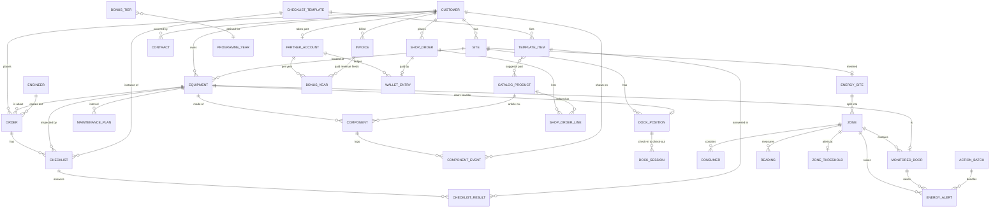

# SHLTR Installation Suite: domain analysis for a Fieldworks rebuild

What the client's Lovable mockup (https://mockup-magic-56.lovable.app) tells us about the business, the
data and the modules a rebuild in Fieldworks needs, read from its pages: the dashboard, Planning, Connect,
Dock, Energie, Apparatuur, Werkbonnen, Onderdelen Shop and Partner Bonus. The other pages in its sidebar
(Opdrachten, Documenten, Focus AI, AI Support) are out of scope, except where these pages share data with
them. Its look, and the theme that copies it, are in `shltr-style.md`.

Sources: the pages' JavaScript bundles (the mock data, labels, formulas and Supabase calls are in them), and
the rendered pages. Only Werkbonnen and Energie's alerts write to the mockup's database (Supabase, tables
`klanten`, `onderdelen`, `activiteiten`, `werkbonnen`, `energie_meldingen`, `focus_batches`,
`focus_batch_items`); its rows aren't in the bundles, so for those tables we know the columns and the
values the code writes or tests for, but no sample rows. Everything else is static or simulated.

Labels used below:

- **[code]**: read in the bundle, with the literal value quoted.
- **[text]**: stated in on-screen copy (an explanation or legal text), not enforced by code.
- **[infer]**: our interpretation.
- **[brief]**: seen on the rendered page, not found in the bundles.

---

## 1. The business in a paragraph

SHLTR (sidebar: "SHLTR / Installation Suite"; programme: "SHLTR Group · Partnerprogramma") installs, services
and inspects building equipment for business customers: loading-dock equipment (dock levellers, Salvo dock
safety: Wheel-Lok chocks, SCP control panels, key storage, beacons; dock shelters), industrial doors
(sectional doors, high-speed roll doors, freezer doors), automatic doors (Besam, Boon Edam), fire doors
("BRD-Branddeur"), stairs and platforms ("bordes / trap", ladders), and HVAC/refrigeration (airco under the
F-gas rules). Its customers are companies with logistics or production buildings, each with one or more sites
(`vestiging`: "Riedel B.V. — Ede", "Vermeer Logistiek — Apeldoorn", "Van Dijk Koeltechniek — Zwolle", "Pakhuis
7", "Bouwgroep De Vries"). It earns from:

1. **Work orders** (`opdrachten`): faults (`Storing`, also `Storing prio`), repairs, installation, maintenance,
   inspection, surveys for quotes (`Offerte opname`), damage, projects. Order-type mix on the customer card [code].
2. **Maintenance contracts and statutory inspections** (`keuring`): checklists against NEN-EN 12604/12453
   (sectional doors), NEN-EN ISO 14122 (stairs), F-gas leak checks [code].
3. **Spare parts** (`onderdelen`), sold through a web shop with article numbers (SD-001…, LV-001…) [code].
4. **Monitoring services** sold as add-on products under the "SHLTR Connect" brand: component condition
   ("Connect"), dock time management (Salvo), and building energy monitoring with a P1 meter ("Energie Module",
   "Energy Intelligence Report") [code].
5. **A partner (loyalty) programme**: a customer account builds up "Partner Omzet" (revenue, sets the level)
   and "Bonus Omzet" (the eligible revenue, sets the bonus). After the year closes it is paid out as a Cash
   Bonus or as a larger "SHLTR Parts Credit" in a "SHLTR Wallet", which can be spent in the parts shop
   [code + text].

**Who the tenant is, and who the users are.** The mockup puts two audiences in one shell:

- _Operational pages_ (Dashboard KPIs, Planning, Klantkaart, Connect, Apparatuur, Werkbonnen, Docks, Energie)
  span several customers. They are the **service company's office and engineers**. The signed-in user is "Jan
  Weggemans, jan@shltr.nl". The customer-card log reads "Opdracht toegewezen aan Weggemans01" and "… aan lev",
  and the work order's engineer defaults to `Lev`. So we read Jan as a SHLTR planner (login `Weggemans01`) and
  Lev as a SHLTR engineer (`monteur`) [code + infer].
- _Account pages_ (Partner Bonus, SHLTR Wallet, "Shop met Parts Credit") speak to a **customer**: "Uw
  samenwerking met SHLTR", "Deelname is beschikbaar voor door SHLTR geaccepteerde klanten en is gekoppeld aan
  het betreffende klantaccount" [text]. The revenue that counts is SHLTR's own invoices to that account
  ("gefactureerde netto-omzet exclusief btw … Alleen volledig betaalde facturen") for contracts, service,
  parts, orders and projects [text].

**Decided (A):** the Fieldworks **tenant is SHLTR**, not each customer. Office users are SHLTR's planners and
office staff, field users are SHLTR's engineers, and a new kind of user, **customer-portal users** (contacts
of a customer account), see the bonus, wallet and shop, and later perhaps their own Connect, dock and energy
reports. The partner programme is computed from SHLTR's invoices to the customer.

The alternative we considered and ruled out (B): every partner installer as its own tenant, with SHLTR a
supplier above the tenants. It would have made the catalogue and the bonus figures cross-tenant data.

The mockup's dates are inconsistent: recent orders are June 2026, the planning August 2026, the energy
simulation September 2026, the bonus "Partner Bonus 2027" with wallet bonus year 2026, and the shop order
`SH-2027-018` [code]. Read the "current year" as 2027 for the programme and 2026 for operations.

---

## 2. Per page

### 2.1 Dashboard (`/`)

**Shows** [code]:

- Greeting "Goedemorgen, Jan", "Hier is wat er vandaag speelt."
- KPI tiles: hard-coded values with a trend line.

  | Label              | Value | Trend            |
  | ------------------ | ----- | ---------------- |
  | `Open opdrachten`  | 24    | `+3 deze week`   |
  | `Actieve klanten`  | 186   | `+12 deze maand` |
  | `Orders deze week` | 47    | `+18%`           |
  | `Laag voorraad`    | 4     | `Bestel tijdig`  |

- **Partner bonus card** ("SHLTR Group Partnerprogramma", "Partner Bonus 2027"). It shows `Huidige status ·
PLATINUM`, the level, `Partner Omzet` €200.000 and `Bonus Omzet` €80.000. Below that: "Naar PLATINUM+",
  "€200.000 van €250.000", progress `round(partnerRevenue / nextThreshold × 100)` = 80 %, and "Nog €50.000 tot
  PLATINUM+" (`nextThreshold − partnerRevenue`). Next come "Verwachte Cash Bonus" €3.040 and "Of verwacht SHLTR
  Parts Credit" €3.840, both captioned "Nog niet besteedbaar · na jaarafsluiting". A button "Bekijk programma
  en voorwaarden" links to `/partner-bonus`.
- **SHLTR Wallet** ("Bonusjaar 2026"):

  | Label            | Value              |
  | ---------------- | ------------------ |
  | `Toegekend`      | €3.750             |
  | `Al besteed`     | – €1.475           |
  | `Nu beschikbaar` | €2.275             |
  | `Geldig tot`     | `31 december 2027` |

  A button "Besteed Parts Credit" goes to `/parts-shop`. Note: "Toegekend saldo staat los van uw verwachte bonus
  over 2027."

- **Recent orders** ("Recente opdrachten", link "Bekijk alle" → `/opdrachten`). Columns: `Nr.`, `Klant`,
  `Status`, `Datum`, `Bedrag`. Rows: 10246 Riedel B.V. `Nieuw` 16/06/2026 €1.245,00; 10245 Bouwgroep De Vries `In
behandeling` €845,00; 10244 Pakhuis 7 `Geaccepteerd` €2.180,00; 10243 Riedel B.V. `Verzonden` €560,00; 10242
  Weggemans Logistiek `Afgerond` €3.420,00.
- **Order status enum** [code]: `Nieuw`, `In behandeling`, `Geaccepteerd`, `Verzonden`, `Afgerond`, in that colour
  order (sky, amber, teal, indigo, emerald). "Geaccepteerd" matches the customer-card log entry "order
  accepted". "Verzonden" (sent) fits a quote, report or parts shipment. [infer] It looks like a sales/quote
  pipeline: new → being handled → accepted by the customer → sent/shipped → done.
- **"Snel naar"**: "Onderdelen Shop · 19 artikelen op voorraad" (the shop lists only 14, of which 3 are low on
  stock, against the KPI's 4); "Klantkaart · Riedel B.V. — laatst geopend"; "3 taken vervallen vandaag:
  Inspectie hoogwerkers, voorraadcontrole filterset, levering SD-005". [infer] That last line implies a
  task/to-do concept with due dates, besides orders.

**Rules:** none beyond the progress arithmetic. Everything is static.

### 2.2 Planning (`/planning`)

- **Shows** [code]: a month calendar (Monday first, 42 cells), month navigation, "Vandaag" (jumps to August
  2026; "today" is fixed at `2026-08-06`), a `Maand`/`Week`/`Dag` toggle (only switches state; the week and day
  views aren't built), a legend and "N afspraken" for the month.
- **Appointment** = `{ datum: "2026-08-03", tijd: "08:30", klant: "Riedel B.V. — Ede", soort }`. The customer
  string is "Customer — site"; the cell shows `tijd customer — soort`.
- **Enum `soort`** [code]: `Storing` (rose), `Reparatie` (sky), `Onderhoud` (emerald), `Inspectie` (violet).
- **Missing:** an engineer per appointment, duration, the order link, drag and drop. The Connect copy promises
  "verlopen keuringen krijgen voorrang in de Planning" [text]. There's no code for it.
- **Fieldworks fit:** these are orders with `scheduledFor`; the schedule module gives the board.

### 2.3 SHLTR Connect (`/connect`): component management per customer

The only page beside Werkbonnen backed by Supabase. Its loader (connect-data) [code]:
`klanten.select("*").order("naam")`, `onderdelen.select("*").order("code")`,
`activiteiten.select("*").order("gebeurd_op", desc).limit(50)`.

**Process banner** [text]:

1. "Koppelen": each component is linked to equipment, location and customer, with the article number from the
   parts shop.
2. "Monitoren": a condition score "op basis van cycli, storingsmeldingen en bevindingen uit werkbonnen".
3. "Plannen": "Onderhoudsinterval bepaalt de volgende beurt; verlopen keuringen krijgen voorrang in de Planning".
4. "Uitvoeren & vastleggen": "Monteur rondt af op de werkbon; conditie, keuring en activiteitenlog worden
   bijgewerkt".

**KPIs**, counted over the selected customer's components [code]: `Onderdelen in beheer` (all), `Kritiek`,
`Aandacht nodig` (status `Aandacht`), `Onderhoud gepland` (status `Gepland`), `In orde`.

**Filters** [code]: customer chips ("Alle klanten" plus one chip per customer with its component count), and the
checkbox "Alleen onderdelen die aandacht nodig hebben" (status ∈ {`Kritiek`, `Aandacht`}).

**Customer panel** (once a customer is chosen) [code]:

- `Klantgegevens`: `plaats` (Vestiging), `contactpersoon`, `email`, `telefoon`, `contract` (free text).
- `Voorkeuren`: `voorkeur_kanaal` ("Contact via"; the icon map gives the values `E-mail`, `Telefoon`,
  `WhatsApp`, `Portaal`), `voorkeur_dag` ("Voorkeursdag"), `voorkeur_tijdslot`, `prioriteit`, `notitie`.
- `Laatste activiteiten`: 5 entries with `soort`, `gebeurd_op` and `omschrijving`.

**Component table "Onderdelenstatus"** [code]:

| Column               | Fields                                                         |
| -------------------- | -------------------------------------------------------------- |
| Onderdeel            | `onderdeel`, then `code` · art. `artikelnummer`, then `advies` |
| Apparatuur / locatie | `apparatuur`, `locatie`                                        |
| Klant                | `klant_id` → `naam`                                            |
| Conditie             | bar plus `conditie`%                                           |
| Laatste              | `laatste_onderhoud`                                            |
| Volgende             | `volgende_onderhoud`                                           |
| Keuring              | `keuring`                                                      |
| Status               | `status`                                                       |

- **Condition colour** [code]: `< 40` rose, `< 70` amber, else emerald.
- **Inspection enum `keuring`** [code]: `Geldig`, `Bijna verlopen`, `Verlopen` (an unknown value is styled as
  `Geldig`).
- **Status enum** [code], with the legend's rules [text]:

  | Status     | Rule                                                                     |
  | ---------- | ------------------------------------------------------------------------ |
  | `Kritiek`  | "Conditie onder 40% of keuring verlopen — binnen 5 werkdagen inplannen." |
  | `Aandacht` | "Slijtage of bevinding vastgelegd — meenemen bij eerstvolgende beurt."   |
  | `Gepland`  | "Onderhoud staat in de Planning, onderdelen zijn gereserveerd."          |
  | `In orde`  | "Binnen interval en keuring geldig — geen actie."                        |

- **Status is stored, not computed**: the page reads `status` as is, so the rule above runs elsewhere (by hand or
  by a job that isn't in the mockup). [infer] The rebuild should compute it, in this precedence: Kritiek >
  Gepland > Aandacht > In orde. Open question: does a planned visit hide a critical state?
- "Bijna verlopen" has no threshold in the code. [infer] Probably 30 days, the same as Fieldworks'
  maintenance `SOON_DAYS`.
- **Activity log "Activiteitenlog"** [code]: the 12 most recent (filtered by customer), showing `gebeurd_op`,
  `soort`, `omschrijving` and `uitgevoerd_door`. `soort` values: [brief] `Onderhoud`, `Melding`, `Storing`,
  `Advies`, `Inspectie`, `Keuring`; [code] the work order writes `Keuring` or `Onderhoud`.

**Workflow:** read-only on this page. Changes come from Werkbonnen (§2.7).

**Not done although the copy claims it:** the condition score is never computed; completing a work order
doesn't touch `conditie` or `volgende_onderhoud`; nothing sends Kritiek to the planning or reserves parts.

### 2.4 Salvo Docks (`/dock`): Dock Time Management

Static data, with door-open seconds counting up live [code].

**Header copy:** "Salvo koppelt de vergrendeling aan de deursturing: de deur gaat pas open als de wielblokkering
actief is."

**Dock** fields [code]:

| Field         | Example or values                                                            |
| ------------- | ---------------------------------------------------------------------------- |
| `id`          | `DOCK 05`                                                                    |
| `positie`     | `P-05 · Expeditie noord`                                                     |
| `state`       | `Laden`, `Bezet`, `Vrij`, `Storing`                                          |
| `vergrendeld` | bool: the Wheel-Lok is on                                                    |
| `deurOpen`    | bool                                                                         |
| `deurSinds`   | seconds open                                                                 |
| `vervoerder`  | `AMEX Transport` or null                                                     |
| `kenteken`    | `84-BNX-7`                                                                   |
| `order`       | `WB-20416`: a work-order/load reference                                      |
| `gepland`     | time slot `09:30 – 10:15`                                                    |
| `opmerking`   | free text                                                                    |
| `scp`         | `SCP-05`                                                                     |
| `scpOk`       | bool; false shows "Sleutelfout"                                              |
| `sleutel`     | `SCP` "Vast in SCP", `Chauffeur` "Bij chauffeur", `Storage` "In Key Storage" |
| `sleutelId`   | `SLV-K05`                                                                    |
| `beacon`      | `groen`, `oranje`, `rood`, `uit`                                             |
| `storageUnit` | `KS-NOORD-1`                                                                 |

**Beacon labels** [code]: `rood` "Rood — niet betreden", `oranje` "Oranje — wacht op vergrendeling", `groen` "Groen
— veilig laden", `uit` "Uit — dock vrij". The sample data correlates them with state:

| State   | Locked                  | Beacon |
| ------- | ----------------------- | ------ |
| Laden   | yes                     | groen  |
| Bezet   | no, key with the driver | oranje |
| Vrij    | –                       | uit    |
| Storing | SCP key error           | rood   |

**KPIs** [code]:

- `Docks bezet`: state ≠ Vrij, shown as "n/total".
- `Vergrendeld`.
- `Niet vergrendeld`: !locked and state ≠ Vrij.
- `Deuren open`.
- `Langste opentijd`: max of the live open seconds, formatted h:mm:ss.

**Rules** [code + text]:

- Door-open timer colour: `≥ 3600 s` rose, `≥ 2400 s` amber, else normal.
- Signals:

  | Open for    | Meaning                                                                        |
  | ----------- | ------------------------------------------------------------------------------ |
  | "< 40 min"  | normal cycle                                                                   |
  | "40–60 min" | "Energieverlies en tocht — melding naar de dockplanner"                        |
  | "> 60 min"  | "Escalatie: mogelijke storing aan de sectionaaldeur, werkbon in SHLTR Connect" |

- The card's warning is red when state = Storing, amber when not locked and not Vrij.
- **Process** [text]: "1. Aanmelden" (driver checks in, Salvo assigns a free position), "2. Vergrendelen"
  (Wheel-Lok clamps the rear wheel; red light outside, green inside), "3. Deur open" (the sectional door unlocks
  only after confirmed locking; the open time is counted), "4. Afmelden" (door closes, Wheel-Lok releases, "tijden
  worden vastgelegd op de werkbon").
- **Components** [text]: "SCP — Salvo Control Panel" (the key release per position; the door stays mechanically
  locked until the key is back), "Key Storage unit" (taking a key out is registered and linked to driver, plate
  and work order), "Beacon".

[infer] This is live telemetry from Salvo hardware at a customer's site, plus a _dock session_ (check-in →
check-out) log. The "werkbon" here is a load or visit record, not a service order: `WB-20416`'s numbering
differs from the service work orders' 205xx.

### 2.5 Energie (`/energie`): "Energie · Gebouw", Energy Module for "Riedel Ede"

A client-side simulation of 30 days of P1 data. Only the alerts are persisted [code].

**Site:** "Riedel Ede — Productielocatie" [code].

- Piekcontract `320 kW · 1.000.000 kWh/jr`.
- Zonnepanelen `+18,2 kW opwek`.
- Main connection "Hoofdaansluiting" with a live P1 reading.
- Floors: `Begane grond`, `1e verdieping`, `Kelder`.

**Zone** [code]: `id` (`Z-R61`), `naam`, `verdieping`, `kW` (base), `kwhVandaag`, `piekKw`, `installaties` (names),
`tone`, `oppervlak` (m²), `delta` (% against the previous period).

- `tone` enum: `nominaal` "Nominaal", `verhoogd` "Verhoogd", `piek` "Piekbelasting", `offline` "Offline".
- Eight zones:

  | Zone     | Name                  | Floor         | kW    | kWh today | Peak kW | m²   | Tone     | Δ     |
  | -------- | --------------------- | ------------- | ----- | --------- | ------- | ---- | -------- | ----- |
  | `Z-R61`  | Vul- en inpakafdeling | Begane grond  | 186.4 | 1482      | 212     | 1240 | piek     | +12.8 |
  | `Z-R62`  | Verpakkingshal        | Begane grond  | 94.2  | 742       | 118     | 880  | verhoogd | +5.4  |
  | `Z-TECH` | Technische Dienst     | Begane grond  | 38.6  | 312       | 44      | 420  | nominaal | −7.2  |
  | `Z-LAB`  | Laboratorium          | 1e verdieping | 27.1  | 198       | 31      | 360  | nominaal | −3.1  |
  | `Z-KV`   | Kantoorvoorzieningen  | 1e verdieping | 19.8  | 156       | 24      | 540  | nominaal | +2.4  |
  | `Z-DOCK` | Expeditie & Docks     | Begane grond  | 51.3  | 408       | 62      | 690  | verhoogd | +9.6  |
  | `Z-IT`   | Serverruimte          | Kelder        | 42.7  | 512       | 45      | 110  | verhoogd | +4.8  |
  | `Z-EXP`  | Externe unit          | —             | 0     | 0         | 0       | 0    | offline  | 0     |

**Installation** (consumer) [code]: `naam`, `zone`, `kW`, `kwh`, icon. Eleven of them, e.g. "CO₂-compressor 1"
(Z-TECH, 24.6 kW, 312 kWh), "Vulautomaat R61", "Inpakrobot R61", "Etiketteermachine PL1", "HVAC-centrale",
"Serverrack A/B", "Lopend transport", "Dock-lift & deuren", "Halverlichting LED", "Klimaatkast laboratorium",
"Werkplek & cafetaria".

**Monitored door** [code]: `id`, `naam`, `soort`, `zoneId`, `zoneNaam`, `cyclus` (min between openings), `openDuur`
(min open per opening), `offset`, `verliesKw` (loss while open), `drempelMin` (alert threshold), `binnen` and
`buiten` (°C).

- `soort` enum: `sectionaal` "Sectionaaldeur", `vries` "Vriescel −22 °C", `koel` "Koelcel +2 °C".
- Doors:

  | Door                            | Type       | Loss kW | Threshold |
  | ------------------------------- | ---------- | ------- | --------- |
  | `D-05` "Sectionaaldeur Dock 05" | sectionaal | 11.4    | 10 min    |
  | `D-06` "Sectionaaldeur Dock 06" | sectionaal | 10.2    | 10 min    |
  | `D-VR1` "Vriescel A"            | vries      | 18.6    | 4 min     |
  | `D-KO1` "Koelcel B"             | koel       | 7.8     | 6 min     |

- D-05 is the same door as Salvo's "DOCK 05" [infer].

**Constants** [code]:

| Constant          | Value                                               |
| ----------------- | --------------------------------------------------- |
| Energy tariff     | `€ 0,28 / kWh` (`Te = 0.28`)                        |
| CO₂ factor        | `0,375 kg / kWh`                                    |
| Simulation start  | 14 Sep 2026                                         |
| Simulation length | 30 days                                             |
| Step              | 10 min (day view) or 2 h (month view), ×1/2/5/10/30 |
| Weekday factors   | Sunday 0.42, Saturday 0.58, else 1, ±5 % noise      |
| Daily profile     | 24 hourly weights                                   |

**Formulas** [code]:

- **Live zone kW** = `base kW × hourFactor × dayFactor × (1 ± 3.5 % noise)`. **Live kWh** = `kwhVandaag ×
fraction of day elapsed` (or month to date).
- **Comparison with the previous period**: `R = Σ(delta_z × kwhVandaag_z) / Σ kwhVandaag_z` (weighted %), and
  previous = `current / (1 + R/100)`. A falling value is shown green (`invert`).
- **KPI tiles**:

  | Tile                                | Value                                           |
  | ----------------------------------- | ----------------------------------------------- |
  | `Actueel vermogen`                  | Σ live kW                                       |
  | `Verbruik vandaag` / `… deze maand` | Σ kWh                                           |
  | `Piekvermogen`                      | max zone `piekKw`, Δ shown × 0.72               |
  | `CO₂-uitstoot`                      | kWh × 0.375                                     |
  | `Actieve alerts`                    | active zone alerts + doors over their threshold |
  | `Verlies open deuren`               | Σ door loss kWh                                 |

- **Zone alert thresholds** (`Energie-alerts per zone`, switch plus `Max. vermogen (kW)` and `Max. verbruik
(kWh)`). Defaults: `maxKw = round(piekKw × f)`, `maxKwh = round(kwhVandaag × f)`, with `f` = 0.95 (piek), 1.08
  (verhoogd), 1.3 (others). Enabled unless offline. The settings live in component state and aren't persisted.
- **Zone alert state**: `ratio = max(liveKw / maxKw, liveKwh / maxKwh)`.

  | State     | Condition    | Shown as                                      |
  | --------- | ------------ | --------------------------------------------- |
  | `actief`  | ratio ≥ 1    | "Overschreden"                                |
  | `bijna`   | ratio ≥ 0.85 | "Bijna bereikt", "binnen 15% van grenswaarde" |
  | `normaal` | otherwise    | "Normaal"                                     |
  | `uit`     | disabled     | "Uitgeschakeld"                               |

- **Door state**: open when `(minuteOfDay + offset) mod cyclus < openDuur`. `overschreden` when open and
  open-minutes ≥ `drempelMin` (badge "Te lang open", otherwise "Open" or "Gesloten"). Loss today =
  `((openings × openDuur × 0.62 + currentOpenMin) / 60) × verliesKw` kWh; cost = kWh × 0.28. The 0.62 factor is
  a simulation fudge. [infer] The real rule is ∫ open time × loss kW.
- **Alert creation → `energie_meldingen`**: inserted automatically on every threshold breach, at most once per
  key. A door alert's key is (door, day, opening cycle), a zone alert's (zone, day, hour). Payload:

  | Field         | Value                                                   |
  | ------------- | ------------------------------------------------------- |
  | `zone_id`     |                                                         |
  | `zone_naam`   | "Sectionaaldeur Dock 05 (Expeditie & Docks)" for a door |
  | `metriek`     | `deur` or `vermogen`                                    |
  | `drempel`     |                                                         |
  | `gemeten`     |                                                         |
  | `ernst`       | `actief`                                                |
  | `aanbeveling` | see below                                               |
  - Sectional-door recommendation: "Sluit {naam} of activeer de dockshelter — {kW} kW warmteverlies."
  - Cold/freezer door: "Controleer {naam}: deur staat {n} min open, {kW} kW extra koelvermogen."
  - Zone: "Verlaag de belasting in {zone} of verschuif piekverbruik naar de daluren."
  - Server-set columns: `id`, `created_at`, `status` (`open` → `in_batch`), `batch_id`.

- **Alerts → Focus AI batch**: the button "Zet N meldingen klaar voor Focus AI" creates `focus_batches {titel:
"Energie-acties · <timestamp>", bron: "Energie"}`. It adds one `focus_batch_items` row per open alert:
  `{ batch_id, actie: aanbeveling, detail: "<zone_naam> · <metriek> <round(gemeten)> van <round(drempel)>
<kW | min open | kWh>", prioriteit: ernst=="actief" ? "Hoog" : "Normaal" }`. It then sets the alerts to
  `{status: "in_batch", batch_id}` and navigates to `/focus-ai?batch=<id>`. The list shows the alert status as
  "Open" or "In Focus AI-batch". (Focus AI itself is out of scope: an action list, apparently worked through by
  an AI assistant.)
- **Savings advice "Besparingsadvies Focus AI"** [code]:
  - shift peak to 12:00–15:00 → "~max(4, kW × 0.08) kW lower peak";
  - "Vergelijking toont R% meer/minder verbruik";
  - night mode for climate and lighting → "~kWh × 0.045 kWh savings".
- **Other UI:** "Exporteer PDF" (`window.print()` with a print header "SHLTR Connect · Energy Intelligence
  Report · Riedel Ede"), scope filter (whole building, floor or zone), "Vergelijking per zone" table (Actueel,
  Huidige periode, Vorige periode, Verschil, Piek, Status).

### 2.6 Apparatuur (`/apparatuur`): equipment register

Static list of 15 units, all `vestiging` "Riedel B.V. - Ede" [code].

- **Fields**: `naam`, `vestiging`, `merk` (brand and model in one string: "Gorter / SR 60", "Crawford / SD 4000",
  "Boon Edam / Draaideur obj 5267"), `locatie` (free text: "Expeditie dock 07", "BG 803.11 Gang Tetra
  koelcentrale"), `staat`, `opdrachten` (count of orders, presumably open ones).
- **Staat enum** [code]: `Goed`, `Aandacht`, `Kritiek`.
- **Category**, derived from the name by keyword [code]:

  | Category                | Keyword rule                                                |
  | ----------------------- | ----------------------------------------------------------- |
  | `Branddeuren`           | starts with "brd", or contains "branddeur" or "brandwerend" |
  | `Sectionaaldeuren`      | contains "sectionaaldeur"                                   |
  | `Automatische deuren`   | contains "automatische", "schuifdeur" or "draaideur"        |
  | `Klim- & trapmateriaal` | contains "trap"                                             |
  | `Overig`                | everything else                                             |

- **UI**: search over name, brand, location and site; category chips with counts; table grouped by category;
  refresh and export buttons (no-ops).
- **Data quirk**: an item "algeheel onderhoud" (general maintenance) is listed as equipment. The client's current
  system apparently uses a pseudo-unit for site-wide work.
- The customer card's work orders mention more units: "SEC-Sectionaaldeur magazijn laaddok LD-04", "Snelroldeur
  grondstoffen GS-02", "Vriessnelroldeur naar diepvriescel groot", and documents for "Hoogwerker Nano Tower" and
  "Verticale masthoogwerker" (aerial work platforms). Unit codes like `BES-3`, `TDTE-13`, `ING-19` and `LD-04` are
  the customer's own asset tags.

### 2.7 Werkbonnen (`/werkbonnen`): "Digitale checkpoint-werkbon"

Supabase-backed and writing [code].

> "Per asset een vaste checklist voor keuring en onderhoud. Elk jaar start een nieuwe lijst; eerdere bonnen
> blijven bewaard."

**Reads:**

- `onderdelen.select("id,code,onderdeel,apparatuur,locatie,klant_id").order("apparatuur")`: the "assets" are
  Connect's component rows.
- `werkbonnen.select("*").order("created_at", desc)`.
- `klanten.select("id,naam")`.

**Asset list:** search over `code apparatuur onderdeel`. Each asset gets a badge: "2026 ✓" when a work order of the
current year with status `Afgerond` exists, else "2026 open".

**Checklist template**, picked by keyword in `apparatuur + onderdeel` [code]:

| Template         | Picked when the text contains | Points |
| ---------------- | ----------------------------- | ------ |
| `sectionaaldeur` | "sectionaal"                  | 9      |
| `airco`          | "airco"                       | 8      |
| `leveller`       | "level", "dock" or "chock"    | 7      |
| `trap`           | "trap" or "bordes"            | 6      |
| `algemeen`       | anything else                 | 4      |

The templates, verbatim (group: point) [code], to seed the checklists module with:

1. **"Sectionaaldeur (NEN-EN 12604/12453)"**:
   - Mechanisch: Torsieveren op spanning en breuk gecontroleerd
   - Mechanisch: Staaldraadkabels vrij van rafels en corrosie
   - Mechanisch: Rollen, scharnieren en geleiderails gesmeerd
   - Mechanisch: Veerbreukbeveiliging en kabelbreukbeveiliging getest
   - Elektrisch: Aandrijving, eindschakelaars en noodstop werkend
   - Veiligheid: Fotocel / lichtscherm stopt en keert deur
   - Veiligheid: Onderloopbeveiliging (sluitkantbeveiliging) getest
   - Afdichting: Bodem-, zij- en bovenafdichting intact
   - Afronding: Keuringssticker geplaatst en logboek bijgewerkt
2. **"Airco / koeltechniek (F-gassen)"**:
   - Binnenunit: Filters gereinigd of vervangen
   - Binnenunit: Verdamper en condensafvoer schoon, pomp werkt
   - Buitenunit: Condensor gereinigd, ventilator vrij
   - Koudemiddel: Lekdichtheidscontrole uitgevoerd (F-gassen)
   - Koudemiddel: Drukken en oververhitting gemeten
   - Elektrisch: Aansluitingen en stroomopname gecontroleerd
   - Prestatie: Uitblaastemperatuur binnen specificatie
   - Afronding: Logboek F-gassen bijgewerkt
3. **"Dockleveller / Salvo dock"**:
   - Hydrauliek: Oliepeil en slangen zonder lekkage
   - Hydrauliek: Cilinders en veiligheidsventiel getest
   - Constructie: Lip, scharnieren en plateau zonder scheuren
   - Veiligheid: Voetbeschermingsplaten en waarschuwingsstrepen aanwezig
   - Salvo: Wheel-Lok / chock vergrendeling getest
   - Salvo: SCP-paneel, sleutel en beacon functioneren
   - Afronding: Keuringssticker geplaatst
4. **"Bordes / trap (NEN-EN ISO 14122)"**:
   - Constructie: Boutverbindingen en verankering vast
   - Constructie: Leuningen en kniesloten stevig
   - Veiligheid: Antislip treden in goede staat
   - Veiligheid: Kickplates aanwezig en onbeschadigd
   - Afwerking: Corrosie en coating beoordeeld
   - Afronding: Rapportage vastgelegd
5. **"Algemene inspectie"**:
   - Algemeen: Visuele inspectie op schade
   - Algemeen: Werking volgens specificatie
   - Veiligheid: Veiligheidsvoorzieningen aanwezig
   - Afronding: Rapportage vastgelegd

**Checklist item** = `{ groep, vraag, resultaat: null | "ok" | "nok" | "nvt", opmerking }`.

- Buttons `Goed` (ok), `Afkeur` (nok), `N.v.t.` (nvt).
- With nok, a remark field appears: "Omschrijf afwijking / benodigd onderdeel…".
- Progress shows "B/V punten" (answered/total).

**Work order (`werkbonnen` row)** [code]:

| Field          | Type or values                          |
| -------------- | --------------------------------------- |
| `id`           |                                         |
| `onderdeel_id` | FK onderdelen                           |
| `jaar`         | int, the current year                   |
| `soort`        | `Keuring`, `Onderhoud`                  |
| `monteur`      | free text, default `Lev`                |
| `items`        | JSON array of checklist items           |
| `opmerking`    | "Algemene opmerking / advies aan klant" |
| `status`       | `Concept`, `Afgerond`                   |
| `afgerond_op`  | timestamp or null                       |
| `created_at`   |                                         |

**Workflow** [code]:

1. On an asset, "Keuring <year>" or "Onderhoud <year>" starts a new checklist from the template. Several per year
   are allowed; the code doesn't stop you.
2. "Concept opslaan" inserts or updates with `status: "Concept"`. A concept can be reopened later ("Verder
   invullen").
3. "Afronden & vastleggen" is enabled only when **every** item is answered (`B === V`). It saves with `status:
"Afgerond"`, `afgerond_op: now`, and then:
   - **inserts an activity**: `activiteiten { klant_id, onderdeel_id, soort: <Keuring|Onderhoud>, omschrijving:
"Werkbon <soort lowercased> <year> afgerond · <n> afkeurpunt(en)" or "… · alles in orde", uitgevoerd_door:
monteur || "Monteur" }`;
   - **updates the component**: `onderdelen { laatste_onderhoud: today, status: nok>0 ? "Aandacht nodig" : "In
orde", keuring: soort=="Keuring" ? (nok>0 ? "Afgekeurd" : "Geldig") : unchanged }`.
   - The writes aren't transactional (three separate calls).
4. "Annuleren" discards the unsaved draft.

**History** ("Historie per jaar"): grouped by year, newest first. Each entry shows "soort · monteur", the date
(`afgerond_op ?? created_at`), a badge (`Concept`, "<n> afkeur", or `Goedgekeurd`), every item with its result and
remark, and the general remark. "PDF" button = print.

**Bugs and inconsistencies to fix, not copy:**

- Completion writes status `Aandacht nodig`, but Connect knows `Aandacht`. It writes keuring `Afgekeurd`, but
  Connect knows `Geldig`/`Bijna verlopen`/`Verlopen` and styles anything else as Geldig.
- Completion doesn't recompute `conditie` or `volgende_onderhoud`, and doesn't set `Kritiek`.
- `monteur` is free text, not a user or engineer.
- The checklist is per component, but its content is per _unit type_ (a sectional door's whole checklist sits
  on its spring set).

### 2.8 Onderdelen Shop (`/parts-shop`)

Static catalogue, client-side cart [code]. "Bestel vervangingsonderdelen voor sectionaaldeuren en levellers".

**Product** [code]:

| Field         | Values                                                     |
| ------------- | ---------------------------------------------------------- |
| `sku`         |                                                            |
| `category`    | `Sectionaaldeuren`, `Levellers`                            |
| `name`        |                                                            |
| `description` |                                                            |
| `unit`        | `per set`, `per stuk`, `per paar`                          |
| `price`       | € excl. VAT; nullable → "Prijs op aanvraag"                |
| `stock`       | `Op voorraad`, `Laag voorraad`, `Op aanvraag`              |
| `popular`     | bool → "Populair"                                          |
| `punten`      | checkpoint texts the part relates to ("Checkpoint-punten") |

**Fourteen products:**

| SKU    | Name                        | Unit     | €   | Stock                   |
| ------ | --------------------------- | -------- | --- | ----------------------- |
| SD-001 | Veerpakket torsieveer       | per set  | 145 | Op voorraad (popular)   |
| SD-002 | Kabelset compleet           | per set  | 89  | Op voorraad             |
| SD-003 | Rolscharnieren set (10 st.) | per set  | 65  | Op voorraad             |
| SD-004 | Bodemafdichting 3 m         | per stuk | 38  | Op voorraad             |
| SD-005 | Openingsbeveiliging sensor  | per stuk | 120 | Laag voorraad (popular) |
| SD-006 | Scharnierband zij (paar)    | per paar | 55  | Op voorraad             |
| SD-007 | Isolatiepaneel compleet     | per stuk | 320 | Op aanvraag             |
| SD-008 | Looplift aandrijving 24V    | per stuk | 385 | Laag voorraad           |
| LV-001 | Hydraulische cilinder       | per stuk | 485 | Op voorraad (popular)   |
| LV-002 | Lipscharnier compleet       | per set  | 265 | Op voorraad             |
| LV-003 | Hydrauliekslang set         | per set  | 138 | Op voorraad             |
| LV-004 | Noodstop schakelaar         | per stuk | 79  | Op voorraad             |
| LV-005 | Veiligheidssteun service    | per stuk | 195 | Laag voorraad           |
| LV-006 | Rubber zijbuffer            | per stuk | 118 | Op aanvraag             |

**Rules** [code]:

- **Stock**: a banner "N artikelen met laag voorraad — bestel op tijd om vertraging te voorkomen" (N = count of
  `Laag voorraad`). `Op aanvraag` items can't be added (disabled button "Op aanvraag").
- **Credit eligibility**: "Parts Credit geschikt" is shown when `price !== null`.
- **Prices**: shown `€ 145,00 excl. BTW`. VAT is never added, not even at checkout.
- **Cart**: quantity +/− per SKU. Total `T = Σ price × qty`.
- **Checkout** "Afrekenen met Parts Credit": shows Beschikbaar saldo (wallet `available` €2.275), Bestelling – T,
  and "Saldo na bestelling" = available − T (red when < 0, with "Uw beschikbare Parts Credit is onvoldoende voor
  deze bestelling"). "Betaal met Parts Credit" is disabled when the cart is empty or the balance would go
  negative.
- **Confirmation**: "Bestelling SH-2027-018 is bevestigd", "<T> Parts Credit gereserveerd". Only Parts Credit is
  accepted: no mixed payment, no invoice.

**Link to work orders:** a part's `punten` repeat the work-order checklist texts word for word
("Torsieveren op spanning en breuk gecontroleerd" → SD-001). [infer] This is the intended link: a failed
checkpoint (Afkeur) suggests the replacement part, and a component row carries the part's `artikelnummer`. The
leveller parts' points don't match the leveller template's texts exactly, so the link would be by template
item id, not by string.

### 2.9 Partner Bonus (`/partner-bonus`)

Static programme data in a shared chunk [code]:

```
{ year: 2027, currentLevel: "PLATINUM", nextLevel: "PLATINUM+", partnerRevenue: 200000,
  bonusRevenue: 80000, nextThreshold: 250000, expectedCash: 3040, expectedPartsCredit: 3840,
  wallet: { sourceYear: 2026, awarded: 3750, spent: 1475, available: 2275, validUntil: "31 december 2027" } }
```

**Tier table** [code]: threshold = "Partner Omzet vanaf". "Cash Bonus*" and "SHLTR Parts Credit*" = threshold ×
rate, i.e. the bonus at the threshold if all of it were eligible.

| From (€) | Level     | Cash % | Cash* (€) | Parts % | Parts* (€) |
| -------- | --------- | ------ | --------- | ------- | ---------- |
| 50.000   | BRONZE    | 2,5    | 1.250     | 3,0     | 1.500      |
| 75.000   | SILVER    | 2,7    | 2.025     | 3,3     | 2.475      |
| 100.000  | GOLD      | 3,0    | 3.000     | 3,8     | 3.800      |
| 150.000  | GOLD+     | 3,5    | 5.250     | 4,3     | 6.450      |
| 200.000  | PLATINUM  | 3,8    | 7.600     | 4,8     | 9.600      |
| 250.000  | PLATINUM+ | 4,0    | 10.000    | 5,0     | 12.500     |
| 350.000  | ELITE     | 4,3    | 15.050    | 5,4     | 18.900     |
| 500.000  | ELITE+    | 4,5    | 22.500    | 5,6     | 28.000     |

**Formulas** [code + text]:

- `level = highest tier with threshold ≤ partnerRevenue`; "Onder € 50.000 ontstaat geen bonus".
- `expectedCash = bonusRevenue × cashRate(level)`: 80.000 × 3,8 % = 3.040.
- `expectedPartsCredit = bonusRevenue × partsRate(level)`: 80.000 × 4,8 % = 3.840.
- Progress = `round(partnerRevenue / nextThreshold × 100)`; remaining = `nextThreshold − partnerRevenue`.
- Wallet `available = awarded − spent`.
- Worked example (tab "Rekenvoorbeeld") [text]: "Van € 200.000 Partner Omzet is € 120.000 projectomzet uitgesloten van
  beide bonusvormen. De overige € 80.000 is kwalificerende Bonus Omzet. Het volledige bedrag bepaalt wel het
  level: Platinum."
- Note "voor de gekozen bonusvorm": the qualifying Bonus Omzet can differ between cash and credit. The revenue
  table's two columns would allow it; in the data they're always equal.

**"Omzet die meetelt"** [code] (category → counts for Partner Level / Cash Bonus / Parts Credit):

| Category                          | Level | Cash             | Parts            |
| --------------------------------- | ----- | ---------------- | ---------------- |
| Onderhoudscontracten              | Ja    | Ja               | Ja               |
| Service en onderhoud              | Ja    | Ja               | Ja               |
| Reguliere onderdelen              | Ja    | Ja               | Ja               |
| Reguliere opdrachten              | Ja    | Ja               | Ja               |
| Projecten met reguliere condities | Ja    | Volgens afspraak | Volgens afspraak |
| Speciale projectprijzen           | Ja    | Volgens afspraak | Volgens afspraak |
| Tenders / netto-netto             | Ja    | Nee              | Nee              |

Plus: "Bij offertes en opdrachtbevestigingen wordt waar mogelijk aangegeven of een project volledig, gedeeltelijk
of uitsluitend voor het Partner Level meetelt." [text] Each quote, order or project needs a **bonus eligibility
classification**: full, partial, or level-only.

**Year cycle** [text]:

1. 1 Jan – 31 Dec Y: build up Partner Omzet and Bonus Omzet.
2. Early Y+1: SHLTR finalises; the partner chooses Cash or Parts Credit.
3. During Y+1: spend the credit while building up Y+1.
4. 31 Dec Y+1: unspent credit of Y expires.

**Conditions** (tab "Voorwaarden", 15 articles) [text], the rules that matter for the model:

| Article             | Rule                                                                                                                                     |
| ------------------- | ---------------------------------------------------------------------------------------------------------------------------------------- |
| Participation       | Only for customers SHLTR accepts; tied to the customer account; revenue and credit not transferable without written consent.             |
| Period              | Calendar year. After year-close SHLTR sets the final Partner Omzet, Bonus Omzet and level.                                               |
| Net revenue         | Invoiced net excl. VAT; returns, credit notes, cancellations and discounts deducted; **only fully paid invoices** count definitively.    |
| Level               | The highest level reached on Partner Omzet; bonus = qualifying Bonus Omzet (for the chosen form) × the level's %.                        |
| Projects            | Count for the level, but aren't automatically bonus-eligible; written agreements prevail; tenders and net-net excluded.                  |
| Choice              | Cash **or** Parts Credit after finalisation, not both, **irreversible**.                                                                 |
| Cash                | Paid out as a credit note or offset against future invoices; may be suspended or offset when payments are overdue.                       |
| Parts Credit        | Available in the Wallet after the choice; an expectation isn't a balance; the premium over cash differs per level.                       |
| Spending            | Only at SHLTR, on designated products; not exchangeable for money; not transferable; **not for orders already placed or open invoices**. |
| Validity            | The calendar year after the bonus year; expires automatically, no cash-out.                                                              |
| Returns after award | SHLTR may offset the bonus difference against future bonuses, credit or invoices.                                                        |
| Exclusions          | Products, product groups, projects and actions can be excluded; not cumulative with other rebates.                                       |
| Changes             | Levels, thresholds, amounts and qualifying groups may change for a next year; awarded bonuses stay.                                      |
| Footer              | "De administratie van SHLTR is leidend, behoudens aantoonbare administratieve fouten."                                                   |

### 2.10 Klantkaart (`/klant`): context only, it shares data with the pages above

Static [code]. It looks modelled on the client's current FSM tool (English labels "Information", "Log", "Order
Types").

- **Address**: "Riedel B.V., Frankeneng 12, 6717AG Ede", with a photo.
- **Order log**: "opdracht gecopieerd vanuit shltr-installation", "Opdracht gewijzigd door SHLTR Installation
  (shltr-installation, 20)", "Opdracht toegewezen aan Weggemans01", "… aan lev", "order accepted". Tones muted,
  link, danger, warning.
- **Customer's work orders**: nr, apparatuur, locatie, datum.
- **Order-type mix (%)**:

  | Type           | %     |
  | -------------- | ----- |
  | Storing        | 49.38 |
  | Reparatie      | 25    |
  | Storing prio   | 7.5   |
  | Installatie    | 6.25  |
  | Onderhoud      | 5     |
  | Projecten      | 3.12  |
  | Offerte opname | 1.55  |
  | Inspectie      | 1.05  |
  | Schade         | 0.85  |
  | Overig         | 0.3   |

- **Building facts**: kantooroppervlak 1400 m², zakelijke ruimte 2000 m², 48 parkeerplaatsen, m² GFA per
  workstation, employee or FTE.
- **Documents** per equipment unit in two folders: "Techniek" and "Facilitair".

---

## 3. Data model

Merged across pages; Dutch names from the mockup in parentheses. Types are for SQLite/drizzle. **T** = tenant-owned
(`organizationId`). The SHLTR tenant owns everything under reading A. Under reading B, the catalogue and the tiers
would be platform-level.

### 3.1 Core records

**Customer** (`klanten`) T

| Field                                   | Type                                        | Notes                                                                                                                                                                                                                                                                  |
| --------------------------------------- | ------------------------------------------- | ---------------------------------------------------------------------------------------------------------------------------------------------------------------------------------------------------------------------------------------------------------------------- |
| name (`naam`)                           | text                                        |                                                                                                                                                                                                                                                                        |
| contactName (`contactpersoon`)          | text                                        |                                                                                                                                                                                                                                                                        |
| email                                   | text                                        |                                                                                                                                                                                                                                                                        |
| phone (`telefoon`)                      | text                                        |                                                                                                                                                                                                                                                                        |
| city (`plaats`)                         | text                                        |                                                                                                                                                                                                                                                                        |
| address                                 | text                                        | from the customer card                                                                                                                                                                                                                                                 |
| contractLabel (`contract`)              | text, nullable                              | [brief] "Full service 24/7", "Full service", "Onderhoud + keuring", "Basis onderhoud": really the contracts module's levels                                                                                                                                            |
| contactChannel (`voorkeur_kanaal`)      | enum `email`, `phone`, `whatsapp`, `portal` | nullable                                                                                                                                                                                                                                                               |
| preferredDay (`voorkeur_dag`)           | enum mon–fri                                | nullable; [brief] one day each ("Dinsdag", "Donderdag")                                                                                                                                                                                                                |
| preferredTimeSlot (`voorkeur_tijdslot`) | start and end time, nullable                | [brief] "07:00-15:00", "06:00-14:00", "09:00-17:00": a window, not a part of day                                                                                                                                                                                       |
| priority (`prioriteit`)                 | enum `normal`, `high`                       | [brief] "Normaal", "Hoog"                                                                                                                                                                                                                                              |
| notes (`notitie`)                       | text, nullable                              | [brief] site-access instructions for the engineer: "Werk buiten productietijden; melden bij receptie expeditie noord.", "Serverruimte alleen betreden met begeleiding.", "Docks 05-08 niet blokkeren tussen 10:00 en 13:00." So they belong in the engineer portal too |
| partner programme fields                |                                             | see 3.5                                                                                                                                                                                                                                                                |

**Site** (`vestiging`) T, new

- customerId, name ("Ede"), address, city.
- Building facts (optional): office m², business m², parking spaces.
- Customer 1 → n sites; equipment and orders are at a site.

**Equipment unit** (`apparatuur`) T

| Field                        | Type                                 | Notes                                                                                                                                                                    |
| ---------------------------- | ------------------------------------ | ------------------------------------------------------------------------------------------------------------------------------------------------------------------------ |
| customerId                   | FK                                   |                                                                                                                                                                          |
| siteId                       | FK, nullable                         |                                                                                                                                                                          |
| name (`naam`)                | text                                 | customer's tag included, e.g. "… BES-3"                                                                                                                                  |
| manufacturer, model (`merk`) | text                                 | "Gorter / SR 60" splits into the two                                                                                                                                     |
| location (`locatie`)         | text                                 | free text inside the site                                                                                                                                                |
| category                     | enum                                 | `fire_door`, `automatic_door`, `sectional_door`, `high_speed_door`, `dock_leveller`, `dock_shelter`, `salvo_dock`, `stairs_platform`, `aerial_platform`, `hvac`, `other` |
| condition (`staat`)          | enum `good`, `attention`, `critical` | derived, see 3.3                                                                                                                                                         |
| serialNumber                 | text                                 | Fieldworks has it                                                                                                                                                        |
| installedAt, warrantyUntil   | day                                  | Fieldworks has them                                                                                                                                                      |

Open-order count = derived.

**Installed component** (`onderdelen`, as Connect uses the word) T, new

| Field                                | Type                             | Notes                                                                                            |
| ------------------------------------ | -------------------------------- | ------------------------------------------------------------------------------------------------ |
| equipmentId                          | FK                               | n:1                                                                                              |
| customerId                           | FK                               | denormalised as in the mockup's `klant_id`; follows from the equipment                           |
| code                                 | text, unique per tenant          | `OC-1041`                                                                                        |
| name (`onderdeel`)                   | text                             |                                                                                                  |
| partSku (`artikelnummer`)            | FK → catalogue product, nullable | `SD-001`                                                                                         |
| condition (`conditie`)               | int 0–100                        |                                                                                                  |
| advice (`advies`)                    | text, nullable                   |                                                                                                  |
| lastServicedOn (`laatste_onderhoud`) | day, nullable                    |                                                                                                  |
| nextDueOn (`volgende_onderhoud`)     | day, nullable                    | from the interval                                                                                |
| inspectionStatus (`keuring`)         | derived                          | `valid`, `expiring`, `expired`, `rejected` (`Geldig`, `Bijna verlopen`, `Verlopen`, `Afgekeurd`) |
| inspectionValidUntil                 | day, nullable                    | needed for the derivation                                                                        |
| status                               | derived enum                     | `critical`, `attention`, `planned`, `ok` (`Kritiek`, `Aandacht`, `Gepland`, `In orde`)           |

[infer] `inspectionStatus` belongs on the _unit_ (a door is inspected, not its spring set). The mockup puts it on
the component because there the component is the only asset.

**Engineer** (`monteur`) T: Fieldworks' `engineer` ("Lev").

**Order** (`opdracht`; Planning `afspraak`) T

| Field                           | Values or notes                                                                                                                                                                        |
| ------------------------------- | -------------------------------------------------------------------------------------------------------------------------------------------------------------------------------------- |
| number                          | 10246                                                                                                                                                                                  |
| customerId, siteId, equipmentId |                                                                                                                                                                                        |
| engineerId                      |                                                                                                                                                                                        |
| type (`soort`)                  | `breakdown` (Storing), `repair`, `maintenance`, `inspection`, `installation`, `survey` (Offerte opname), `damage`, `project`, `other`; "Storing prio" = breakdown with priority urgent |
| status                          | the mockup's pipeline is `new`, `in_progress`, `accepted`, `sent`, `done` (Nieuw…Afgerond)                                                                                             |
| scheduledFor                    | `datum` + `tijd`                                                                                                                                                                       |
| amount (`bedrag`)               |                                                                                                                                                                                        |
| bonusEligibility                | `full`, `partial`, `level_only`, `excluded`; from the bonus rules                                                                                                                      |
| log                             | assignment and acceptance entries                                                                                                                                                      |

**Task** (`taak`) T, from the dashboard's "taken vervallen vandaag": title, due day, done, related record. Out of
scope for now.

### 3.2 Work orders (checklists)

**Checklist template** (platform seed, editable per tenant) T

- key (`sectionaaldeur`, `airco`, `leveller`, `trap`, `algemeen`), label (incl. the norm), equipment categories
  it applies to.
- Items: position, group (`groep`), text (`vraag`), suggested part SKU(s) (`punten` reversed).

**Checklist / work order** (`werkbonnen`) T

| Field                        | Type or values                                                      |
| ---------------------------- | ------------------------------------------------------------------- |
| orderId                      | FK, recommended; the mockup links to the component and year instead |
| equipmentId (or componentId) | FK                                                                  |
| year (`jaar`)                | int                                                                 |
| kind (`soort`)               | `inspection` (Keuring), `maintenance` (Onderhoud)                   |
| engineerId (`monteur`)       | FK                                                                  |
| templateKey                  | text                                                                |
| status                       | `draft` (Concept), `completed` (Afgerond)                           |
| remarks (`opmerking`)        | text                                                                |
| completedAt (`afgerond_op`)  | moment                                                              |
| createdAt                    | moment                                                              |

Derived: result = `rejected` ("n afkeur") if any item is nok, else `approved` ("Goedgekeurd").

**Checklist result** (one row per item, rather than the mockup's JSON) T: checklistId, templateItemId (with a
snapshot of group and text), result `ok`, `nok`, `nvt` (null until answered), remark.

**Component event** (`activiteiten`) T

| Field                           | Type or values                                                                                                                          |
| ------------------------------- | --------------------------------------------------------------------------------------------------------------------------------------- |
| customerId (`klant_id`)         | FK                                                                                                                                      |
| componentId (`onderdeel_id`)    | FK, nullable                                                                                                                            |
| equipmentId                     | FK, nullable                                                                                                                            |
| kind (`soort`)                  | `maintenance`, `report`, `breakdown`, `advice`, `inspection`, `certification` (Onderhoud, Melding, Storing, Advies, Inspectie, Keuring) |
| description (`omschrijving`)    | text                                                                                                                                    |
| occurredAt (`gebeurd_op`)       | moment                                                                                                                                  |
| performedBy (`uitgevoerd_door`) | user/engineer FK plus a name snapshot                                                                                                   |

### 3.3 Derivations (to implement server-side)

**Component status:**

- `critical` if condition < 40, or the inspection has expired or was rejected [code legend + werkbon rejection].
  Then plan within 5 working days.
- else `planned` if an open order is scheduled for it.
- else `attention` if the last checklist had nok items or wear was recorded.
- else `ok`.

**Inspection status:** `expired` if validUntil < today; `expiring` if validUntil < today + N days (N = 30?);
`rejected` if the last inspection checklist had nok; else `valid`. The validity period per norm or category is
unknown, typically 12 months.

**Equipment `staat`:** the worst of its components and its own inspection (Kritiek > Aandacht > Goed) [infer].

**On completing an inspection or maintenance checklist** (one transaction):

- the component's/unit's lastServicedOn = today;
- nextDueOn = advance by its interval;
- inspectionValidUntil = today + validity when kind = inspection and there are no nok items;
- status recomputed;
- a component event `"Werkbon <kind> <year> afgerond · n afkeurpunt(en)" | "· alles in orde"`;
- [infer] for each nok item with a suggested part: a draft parts line or a follow-up order.

**Condition score:** the mockup's inputs are "cycli, storingsmeldingen en bevindingen uit werkbonnen"; there's no
formula. A proposal for the client: 100 − w₁·(cycles / rated cycles) − w₂·(breakdowns last 12 months) −
w₃·(nok items last checklist), clamped to 0–100.

### 3.4 Monitoring

**Dock position** (Salvo) T

| Field                | Type or values           |
| -------------------- | ------------------------ |
| siteId               | FK                       |
| code (`id`)          | `DOCK 05`                |
| position (`positie`) | `P-05 · Expeditie noord` |
| doorEquipmentId      | FK → sectional door      |
| levellerEquipmentId  | FK                       |
| scpCode              | text                     |
| keyId (`sleutelId`)  | text                     |
| keyStorageUnit       | text                     |

Live state (from the integration):

- state: `free` (Vrij), `occupied` (Bezet), `loading` (Laden), `fault` (Storing);
- locked, doorOpen, doorOpenSince (moment), scpOnline;
- keyLocation `scp`, `driver`, `storage`;
- beacon `green`, `orange`, `red`, `off`.

**Dock session** T: dockPositionId, carrier (`vervoerder`), licence plate (`kenteken`), order/reference
(`order`), planned slot start/end (`gepland`), checkedInAt, lockedAt, doorOpenedAt, doorClosedAt, checkedOutAt,
remarks. Derived: door-open duration, colour bands 40/60 min.

**Energy:**

| Entity                    | Fields                                                                                                                                       |
| ------------------------- | -------------------------------------------------------------------------------------------------------------------------------------------- |
| Energy site (meter) T     | siteId, contracted peak kW (320), contracted kWh per year (1.000.000), PV capacity, tariff €/kWh (0.28), CO₂ factor (0.375)                  |
| Zone T                    | siteId, code (`Z-R61`), name, floor (`verdieping`), area m²                                                                                  |
| Consumer / installation T | zoneId, name, equipmentId (nullable), rated kW                                                                                               |
| Monitored door T          | zoneId, equipmentId (door), kind `sectional`, `freezer`, `cold`, loss kW while open, alert threshold minutes, inside and outside setpoint °C |
| Reading T                 | per zone or meter per interval (e.g. 15 min): kW avg, kW peak, kWh; per door: open/close events                                              |
| Zone threshold T          | zoneId, enabled, max kW, max kWh (the mockup doesn't persist it)                                                                             |

**Energy alert** (`energie_meldingen`) T

| Field                          | Values                                                                                          |
| ------------------------------ | ----------------------------------------------------------------------------------------------- |
| zoneId (`zone_id`)             |                                                                                                 |
| label (`zone_naam`)            |                                                                                                 |
| metric (`metriek`)             | `power` (vermogen), `door` (deur), [infer] `energy` (kWh; the batch formatter has a kWh branch) |
| threshold (`drempel`)          |                                                                                                 |
| measured (`gemeten`)           |                                                                                                 |
| severity (`ernst`)             | `active`; [infer] `near` was meant too                                                          |
| recommendation (`aanbeveling`) |                                                                                                 |
| status                         | `open`, `in_batch`, [infer] `done`                                                              |
| batchId (`batch_id`)           |                                                                                                 |
| createdAt (`created_at`)       |                                                                                                 |

**Action batch** (`focus_batches`, `focus_batch_items`; Focus AI, out of scope):

- batch: title (`titel`), source (`bron`: "Energie", …);
- item: batchId, action (`actie`), detail, priority (`prioriteit`: `Hoog`, `Normaal`), createdAt.

### 3.5 Partner programme and shop

| Entity                                              | Fields                                                                                                                                                                                                       |
| --------------------------------------------------- | ------------------------------------------------------------------------------------------------------------------------------------------------------------------------------------------------------------ |
| Programme year rules (per year; platform or tenant) | year, list of tiers (threshold, level, cash %, parts %), validity rule (credit valid until 31 Dec of year+1)                                                                                                 |
| Revenue category rule                               | category (the 7 above) → counts for level (bool), cash (`yes`, `no`, `by_agreement`), parts (same)                                                                                                           |
| Partner account T                                   | customerId (1:1), accepted (bool or date), SHLTR account number                                                                                                                                              |
| Bonus year T                                        | customerId, year, partnerRevenue, bonusRevenueCash, bonusRevenueParts, level, status `accruing` → `finalised` → `chosen`, choice `cash`, `parts_credit` (irreversible), finalisedAt, chosenAt, awardedAmount |
| Wallet ledger entry T                               | customerId, bonusYear, kind `award`, `spend`, `reversal`, `expiry`, `adjustment`, amount (signed), shopOrderId, validUntil, at                                                                               |

- Revenue lines are derived from paid invoices (a view, not stored): invoice line amount excl. VAT, category,
  eligibility.
- Wallet balance per bonus year = Σ entries. The mockup's awarded / spent / available are views of the ledger.
- **Catalogue product** (shop): sku, category, name, description, unit `set`, `piece`, `pair`, price excl. VAT
  (nullable = on request), stock status (derived from stock: `in_stock`, `low`, `on_request`), popular, credit
  eligible (bool: "aangewezen producten"), related checklist items.
- **Shop order** T: number (`SH-2027-018`), customerId, placedBy (portal user), status
  `placed`/`reserved`/`confirmed`/`shipped`/`delivered`/`cancelled` (the mockup knows only "bevestigd" and
  "gereserveerd"), payment `parts_credit` (plus [infer] `invoice`), total excl. VAT, VAT, lines (sku, qty, unit
  price).

### 3.6 ER diagram



---

## 4. Mapping onto Fieldworks

What exists (read from `src/lib/server/db/schema.ts`, `src/lib/models.ts` and the modules' `server/schema.ts` and
`model.ts`):

- **Core tables:**
  - `customer` (code, name, contactName, email, phone, city, country, segment `enterprise`/`mid_market`/`small_business`);
  - `engineer` (name, email, phone, specialty `electrical`/`mechanical`/`hvac`/`plumbing`/`controls`, region,
    hourlyRate, active, userId);
  - `equipment` (serialNumber, model, manufacturer, category `generator`/`chiller`/`boiler`/`compressor`/`pump`/`elevator`/`air_handler`,
    status `operational`/`needs_service`/`out_of_service`/`decommissioned`, customerId, installedAt, warrantyUntil;
    **no site, no location**);
  - `order` (number, customerId, equipmentId, engineerId, type `installation`/`maintenance`/`repair`/`inspection`,
    status `quote`/`scheduled`/`in_progress`/`completed`/`invoiced`/`cancelled`, priority `low`/`normal`/`high`/`urgent`,
    description, scheduledFor, completedAt, laborHours);
  - `order_note`, `order_signoff` (signature on completion), `activity` (the audit log).
- **Engineer portal** (`src/routes/(field)/my/`: `getMyWork`, `startWork`, `logHours`, `addNote`, `completeWork`,
  signature pad), with the slot `portal.order`.
- **Modules:**
  - `contracts`: contract (level `basic`/`standard`/`premium`, startsOn, endsOn, monthlyFee, responseHours) plus
    covered equipment;
  - `maintenance`: maintenance_plan per unit (orderType `maintenance`/`inspection`, intervalMonths, nextDueOn,
    anchorDay, paused, lastOrderId), settings with autoCreate, leadDays 30, remindCustomers; a daily job that
    creates orders; `SOON_DAYS = 30`; `nextDue` column in the equipment list;
  - `materials`: material (sku, name, unit `pcs`/`m`/`kg`/`l`, unitPrice, stock), order_line, stock_movement
    (`opening_balance`/`receipt`/`adjustment`/`consumption`/`return`), low-stock thresholds per unit, stock levels
    `out`/`low`/`in_stock`, `MAT-0001` numbers, dashboard stats;
  - `invoices`: invoice (status `draft`/`sent`/`paid`/`void`, vatRate, paidOn), invoice_line (source, orderId),
    billing settings with VAT 21;
  - `schedule`: a week board over orders, no tables.
- **Extension points:**

  | Kind          | Points                                                                                                                       |
  | ------------- | ---------------------------------------------------------------------------------------------------------------------------- |
  | Slots         | `dashboard.stats`, `dashboard.cards`, `equipment.detail.side`, `orders.detail.side`, `portal.order`, `contracts.detail.side` |
  | Form slot     | `orders.form`                                                                                                                |
  | List columns  | `equipment.list`                                                                                                             |
  | Bulk actions  | `orders.list`                                                                                                                |
  | Collectors    | `orders.costs`, `orders.adjustPrices`, `orders.tag`, `invoices.billableItems`, `jobs.daily`                                  |
  | Event         | `orders.committed`                                                                                                           |
  | Save hook     | `orders.saving`                                                                                                              |
  | Core services | `createOrders`, `scheduleOrder`, `setOrdersStatus`                                                                           |

### 4.1 Feature by feature

| Mockup                                                              | Fieldworks today                                                  | Verdict                                                                                                                                                                                                                                                                                                                                                                                                                                                        |
| ------------------------------------------------------------------- | ----------------------------------------------------------------- | -------------------------------------------------------------------------------------------------------------------------------------------------------------------------------------------------------------------------------------------------------------------------------------------------------------------------------------------------------------------------------------------------------------------------------------------------------------- |
| Customers (`klanten`)                                               | `customer`                                                        | **Extend core**: address, contact channel, preferred day, time slot, priority, notes. These are generic for any field-service tenant, so core rather than a module. `contract` comes from the contracts module (a `customers.detail.side` slot, a new point).                                                                                                                                                                                                  |
| Sites (`vestiging`)                                                 | none (`city` on customer only)                                    | **New core table `customer_site`** plus `equipment.siteId`. Planning, Apparatuur, Docks and Energie all hang off a site. Order site = its equipment's site, or its own `siteId` when no unit.                                                                                                                                                                                                                                                                  |
| Equipment (`apparatuur`)                                            | `equipment`                                                       | **Extend core**: `location` text and `name` (the customer's tag). Categories need door, dock, stair and aerial categories: replace the fixed `equipmentCategories` with SHLTR's set, or make categories tenant-configurable (the bigger change; `specialtyForCategory` and the seed depend on the enum). `staat` Goed/Aandacht/Kritiek: derived by the components module, shown as an `equipment.list` column; core `status` stays operational/out-of-service. |
| Brand / model                                                       | `manufacturer`, `model`                                           | Exists (split "Gorter / SR 60").                                                                                                                                                                                                                                                                                                                                                                                                                               |
| Order types                                                         | `orderTypes` = 4                                                  | **Extend core enum**: add `breakdown` (Storing; most of the volume: 49 %), `survey` (Offerte opname), `damage`, `project`, `other`. "Storing prio" = breakdown + `urgent`.                                                                                                                                                                                                                                                                                     |
| Order statuses Nieuw/In behandeling/Geaccepteerd/Verzonden/Afgerond | quote/scheduled/in_progress/completed/invoiced/cancelled          | Mostly a **label and mapping** question: Nieuw ≈ quote, In behandeling ≈ in_progress, Afgerond ≈ completed. "Geaccepteerd" and "Verzonden" don't exist: ask (§5). If they are a quote's lifecycle, that's a small `quotes` module, not a core status.                                                                                                                                                                                                          |
| Planning                                                            | `schedule` module (week board)                                    | **Extend schedule**: month view and day view; the legend by order type. Appointments are orders with `scheduledFor`.                                                                                                                                                                                                                                                                                                                                           |
| Engineer ("Lev")                                                    | `engineer` + portal                                               | Exists. The work order's `monteur` becomes the order's `engineerId`.                                                                                                                                                                                                                                                                                                                                                                                           |
| Werkbon checklists                                                  | none (portal has hours, notes, signature)                         | **New module `checklists`** (below).                                                                                                                                                                                                                                                                                                                                                                                                                           |
| Connect components, condition, inspection status, activity timeline | none (maintenance has plans and next due)                         | **New module `components`** (below), enhancing maintenance and checklists.                                                                                                                                                                                                                                                                                                                                                                                     |
| Maintenance interval → "Volgende"                                   | `maintenance` (intervalMonths, nextDueOn, daily job makes orders) | Exists at **unit** level. "Volgende onderhoud" = the plan's nextDueOn. Inspection plans = `orderType: inspection`. Kritiek → "plan within 5 working days": a maintenance or components daily job that `createOrders` with priority high and a due date 5 working days out.                                                                                                                                                                                     |
| Parts on orders, stock                                              | `materials` (catalogue, stock, low-stock levels, lines)           | Exists. The shop's catalogue = materials plus shop fields (description, category, popular, credit-eligible, related checkpoints, "on request"). "Laag voorraad" KPI = materials' dashboard stat.                                                                                                                                                                                                                                                               |
| Parts shop                                                          | none                                                              | **New module `parts-shop`** (requires materials), with a **customer portal**.                                                                                                                                                                                                                                                                                                                                                                                  |
| Partner bonus + wallet                                              | `invoices` holds paid net revenue per customer                    | **New module `partner-programme`** (requires invoices).                                                                                                                                                                                                                                                                                                                                                                                                        |
| Docks                                                               | none                                                              | **New module `docks`**.                                                                                                                                                                                                                                                                                                                                                                                                                                        |
| Energie                                                             | none                                                              | **New module `energy`**.                                                                                                                                                                                                                                                                                                                                                                                                                                       |
| Energy alerts → Focus AI batches                                    | none                                                              | Out of scope; in `energy`, alerts can make an order (`createOrders`) or join an "action list".                                                                                                                                                                                                                                                                                                                                                                 |
| Klantkaart (log, order-type mix, documents, building facts)         | customer detail with activity card                                | Order-type chart = a small core chart. Documents = **attachments** (not in Fieldworks; a separate `documents` module, ignored for now). Building facts = site fields.                                                                                                                                                                                                                                                                                          |
| Dashboard KPIs                                                      | dashboard + `dashboard.stats`/`dashboard.cards`                   | Exists. Open orders, active customers and orders this week are core stats; "Laag voorraad" from materials; the bonus and wallet cards from partner-programme via `dashboard.cards`.                                                                                                                                                                                                                                                                            |
| Activity "log"                                                      | core `activity` (audit)                                           | Keep the audit log as is. The mockup's `activiteiten` is a _customer-facing service history_ (Melding, Advies…): the components module's own `component_event` table. Checklists and orders write to it through a components `api/` service, or components listens to `orders.committed`.                                                                                                                                                                      |
| End-customer and partner users                                      | roles owner/admin/member/engineer; no customer users              | **New: a customer portal** (role `customer`, a member linked to a `customer` record, route group like `(field)`, gated set `forCustomers` scoped to the customer as well as the tenant). Needed for bonus, wallet and shop, and later for customers to see their own Connect, dock and energy pages. This is a core change.                                                                                                                                    |

### 4.2 Proposed new modules

All of these are optional modules in `src/modules/<id>/`. Their tables reference core tables through composite
tenant keys; changes to core records go through core services.

#### `checklists`: digital work orders (keuring/onderhoud)

- **Tables**:
  - `checklist_template` and `checklist_template_item` (seeded with the 5 templates and their 34 points; tenant-editable later);
  - `checklist` (orderId, equipmentId, templateKey, kind `inspection`/`maintenance`, year, status `draft`/`completed`, remarks, completedAt);
  - `checklist_result` (checklistId, templateItemId, group and text snapshot, result `ok`/`nok`/`nvt`, remark).
- **Template choice**: by equipment category (not the mockup's keyword match), with the general template as fallback.
- **Rules**: completing requires every point answered; a checklist is tied to an order of type
  inspection/maintenance; history per unit per year; result `approved` or "n rejections".
- **Extension points used**:
  - `portal.order` slot: fill the checklist in the field. Needs `moduleRemote("checklists", "engineer")`, as
    materials does.
  - `orders.detail.side` slot: office view, PDF.
  - `equipment.detail.side` slot: "Historie per jaar".
  - `orders.saving` save hook: refuse an order going to `completed` while its checklist has unanswered points;
    or complete a draft checklist in the same transaction.
  - New event `checklists.completed` in `api/extensions.ts`, carrying unit, kind and nok items. Components and
    maintenance use it to update condition, inspection validity and next due inside the transaction, so it
    should be a **save-style hook**, not `emit()`. Alternatively components _requires_ checklists and calls its
    API.
  - `jobs.daily`: none.
  - Print/PDF route: `/checklists/<id>/print`.
- **Dependencies**: none required; `enhances: ["maintenance", "materials"]`. With materials, a nok point's
  suggested SKU can become a draft order line through a materials service.
- **Messages**: the template texts are tenant data (Dutch norms), not Paraglide messages. Only UI labels go in
  `en`/`nl`.

#### `components`: SHLTR Connect (component register, condition, inspection status, service history)

- **Tables**: `component` (equipmentId, code `OC-…` via `nextNumber`, name, materialId nullable, condition,
  advice, lastServicedOn, nextDueOn, inspectionValidUntil), `component_event` (customerId, equipmentId,
  componentId, kind, description, occurredAt, performedBy), and settings (Kritiek threshold 40, Aandacht band 70,
  "expiring" days, working days to plan Kritiek: 5).
- **Derived** (in SQL for lists): component status, inspection status, the unit's `staat`.
- **Extension points used**:
  - `equipment.list` columns: condition, inspection status, staat;
  - `equipment.detail.side` slot: component table and timeline;
  - a new `customers.detail.side` slot: preferences, last activities, component status;
  - `dashboard.stats`: Kritiek, Aandacht, Gepland, In orde counts;
  - `jobs.daily`: recompute expiring and expired, and create orders for Kritiek units through `createOrders`
    (idempotent: skip when an open order exists);
  - `orders.committed` event: log "Storing" and "Reparatie" orders into the history.
  - Its own page `/components` = the Connect overview (KPIs, customer chips, "only needing attention" filter,
    server-side list).
- **Dependencies**: `enhances: ["checklists", "maintenance", "materials"]`. Or `requires: ["checklists"]` if
  condition updates on completion are core to it (recommended: Connect without work orders has no input).
- **Open design question**: do components need to exist at all, or are the "onderdelen" just units? If SHLTR only
  needs per-door condition and inspection status, put condition and inspection on the unit (equipment-level
  columns from this module) and drop the component table. The mockup's spare-part article number on each row
  argues for keeping it.

#### `partner-programme`: Partner Bonus + SHLTR Wallet

- **Tables**: `programme_year` (year, tiers JSON or a `bonus_tier` table, credit validity), `revenue_category`
  rules, `partner_account` (customerId, acceptedOn), `bonus_year` (customerId, year, finalised figures, level,
  choice, status, finalisedAt, chosenAt), `wallet_entry` (ledger).
- **Logic**:
  - Expected figures = paid invoices of the year, excl. VAT, minus credits. Paid is `paidOn` in that year: does
    payment date or invoice date decide the year? Ask.
  - Split by revenue category and eligibility. Needs a category and eligibility on invoice lines or orders:
    an `orders.form` part ("counts for: full / partial / level only") and an `invoices.billableItems` source tag.
  - Level from tiers; expected cash and credit.
  - Year-close (manager action or daily job in January): status `finalised`.
  - The customer's choice (portal; once, irreversible) → wallet `award` entry with validUntil 31-12-(year+1), or
    a cash credit note (an invoices-module credit: needs a credit-note/negative-invoice feature, which invoices
    lacks).
  - Daily job: `expiry` entries on 1 January.
- **Extension points used**: `dashboard.cards` (bonus and wallet cards), the new `customers.detail.side` (the
  account's level and wallet in the office), customer-portal pages, `jobs.daily`, and the `invoices` API
  (requires invoices) to read paid revenue.
- **Dependencies**: `requires: ["invoices"]`, `enhances: ["parts-shop"]`.

#### `parts-shop`: Onderdelen Shop

- **Tables**: `shop_product` (materialId 1:1, category, description, popular, creditEligible, onRequest, related
  checklist items), `shop_order` (number `SH-YYYY-NNN` via `nextNumber`, customerId, placedBy, status, payment,
  totals), `shop_order_line`.
- **Rules**:
  - "On request" items can't be ordered.
  - Stock badge from materials' stock level (`low` → "Laag voorraad").
  - Credit payment can't exceed the wallet's available balance, which must be checked in the same transaction
    as the wallet `spend` entry.
  - Credit can't pay for placed orders or open invoices.
  - VAT: ask (§5).
  - A placed order reserves stock: a `stock_movement` through a materials service. Materials' movement kinds
    have no `reservation`, so add one or reserve on confirmation.
  - Fulfilment: an order → a delivery, possibly an invoice through invoices for the non-credit part.
- **Extension points used**: customer-portal pages; the office list `/parts-shop` with orders to confirm and ship;
  `dashboard.stats` (open shop orders).
- **Dependencies**: `requires: ["materials"]`, `enhances: ["partner-programme", "invoices"]`. Credit payment is
  only offered when partner-programme is on, which means partner-programme's `api/` exposes `walletBalance()`
  and `spendCredit(tx, …)`. If the shop calls them, the shop must _require_ partner-programme, or
  partner-programme declares a payment hook the shop calls. Simplest: the shop requires partner-programme.

#### `docks`: Salvo Dock Time Management

- **Tables**: `dock_position` (siteId, code, position label, door and leveller equipment ids, scp, key id, key
  storage unit), `dock_state` (current live state; one row per position, updated by the integration),
  `dock_session` (check-in → check-out log), `dock_alert_rule` (40/60 minute bands).
- **Integration**: a module endpoint `routes/(api)/ingest/+server.ts`, or a poller, receiving Salvo events (lock,
  unlock, door open/close, key moves, SCP faults). Authenticated per tenant with a token. Each event updates
  `dock_state`, appends to `dock_session`, and announces changes for a `query.live` board, as the schedule's
  `watchSchedule` does.
- **Rules**: door open ≥ 40 min → notify the dock planner; ≥ 60 min → `createOrders` a breakdown order on the door
  unit (idempotent per session); SCP fault → state `fault`, beacon red.
- **Extension points used**: `equipment.detail.side` (dock usage on a door or leveller), `dashboard.stats`
  (docks occupied, unlocked), its own page `/docks` (live board).
- **Dependencies**: none; `enhances: ["energy"]`.

#### `energy`: Energie Module

- **Tables**: `energy_site`, `energy_zone`, `energy_consumer` (equipmentId optional), `monitored_door`
  (equipmentId), `energy_reading` (aggregated, e.g. 15-min buckets; keep raw P1 telegrams out of the Durable
  Object's database), `zone_threshold`, `energy_alert`.
- **Rules**: the formulas of §2.5 with real data:
  - live kW and kWh per zone;
  - comparison with the previous period (day against yesterday, month against last month);
  - thresholds with states active, near (≥ 0.85) and normal;
  - door loss = Σ open minutes / 60 × loss kW;
  - cost = kWh × tariff; CO₂ = kWh × 0.375;
  - an alert at most once per key (door per opening; zone per hour);
  - recommendation texts (Paraglide messages with parameters).
- **Alert workflow**: `open` → assigned to an order via `createOrders` (the Fieldworks equivalent of "Focus AI
  batch") → `done`.
- **Extension points used**: its own pages `/energy` (site picker, building view, door watch, alerts, zone
  thresholds, PDF report), `dashboard.stats` (active alerts), `jobs.daily` (a daily/monthly report, mail to the
  customer outside the transaction), and an ingest endpoint.
- **Dependencies**: none; `enhances: ["docks"]` (show Salvo door state next to door loss; an energy alert on a
  dock door can link the dock session).
- **Caution**: high-frequency writes on Cloudflare's single Durable Object hold every request
  (`docs/agents/database.md`). Ingest in batches, aggregate before writing, or keep the time series outside the
  app's database.

### 4.3 Core changes these need

These are needed before any of the modules are useful:

1. `customer_site` and `equipment.siteId` / `equipment.location` (+ migration, seed, lists, forms, isolation tests).
2. Customer contact preferences and notes.
3. Order types `breakdown`, `survey`, `damage`, `project`, `other`. Equipment categories for SHLTR's product
   lines, or tenant-defined categories.
4. New extension points: `customers.detail.side` slot; a save-style hook on checklist completion (module-owned
   in checklists' `api/extensions.ts`).
5. A **customer portal** (role, route group, gated set, customer scoping). This is the largest core change and
   only needed for the partner programme and shop (and customer-facing reports).
6. For bonus categories: an eligibility/category field on orders (form part) or on invoice lines.

---

## 5. Open questions for the client

1. ~~Who uses the suite?~~ Settled: SHLTR is the tenant, with a customer portal (§1).
2. **Who is a "partner"**: any accepted B2B customer, or only installers/resellers who buy from SHLTR? Do
   end-customer contacts log in at all?
3. **Bonus source data**: should we compute Partner Omzet and Bonus Omzet from invoices in the app, or import
   them from SHLTR's ERP ("De administratie van SHLTR is leidend")? If computed: does an invoice count in the
   year it's issued or the year it's paid? How are credit notes and returns entered?
4. **Revenue classification**: how is an order, project or invoice line marked as contract / service / regular
   part / regular order / project (regular conditions) / special project price / tender? Who sets "volgens
   afspraak"? Can a project count partially, with which percentage?
5. **Cash and Parts Credit bases**: can the qualifying Bonus Omzet differ between Cash and Parts Credit ("voor de
   gekozen bonusvorm")?
6. **Year-close**: who finalises it and when? How does the customer choose, and is there a deadline? What happens
   without a choice? How is the Cash Bonus paid: a credit note in the app, or outside it?
7. **Wallet**: can credit from two bonus years coexist, and which is spent first (expiring first)? Can a shop
   order be paid partly with credit and partly on invoice? Is VAT charged on credit-paid orders?
8. **Parts shop**: which products are credit-eligible ("aangewezen producten")? Is the shop SHLTR's own stock
   (our materials module) or a supplier catalogue? Do prices differ per customer or level? What happens after
   "bevestigd": pick, ship, deliver, invoice? Who handles "Op aanvraag"? What does "gereserveerd" mean?
9. **Order pipeline** (for now: the Dutch labels of `quote`, `in_progress` and `completed` become
   "Nieuw", "In behandeling" and "Afgerond"; the statuses themselves stay): what do "Geaccepteerd" and "Verzonden" mean on the dashboard: a quote accepted by the
   customer, a report sent? Are these quotes, work orders or shop orders? What is "opdracht gecopieerd vanuit
   shltr-installation", a link with another system?
10. **Work order scope**: one checklist per _unit_ per order (our proposal), or per component as in the mockup?
    Must a keuring and an onderhoud of the same year be separate? Is the customer signature (Fieldworks has one)
    required on the work order?
11. **Inspection validity**: how long is a keuring valid per norm or category (12 months?)? When does it become
    "Bijna verlopen" (30 days?)? Does a rejected inspection (Afkeur points) make the unit Kritiek at once, or only
    "Aandacht"?
12. **Condition score**: is it entered by the engineer, computed (from cycles, faults, nok points), or read from
    sensors (cycle counters on doors)? Which weights?
13. **Status precedence**: does "Gepland" hide a critical state? Should Kritiek create an order automatically
    (within 5 working days) or only flag it for the planner?
14. **Components**: does SHLTR really track spare-part-level components (spring set, cables) per door, each with an
    article number? Or is condition per door enough?
15. **Customer preferences** (settled for now: one preferred day and one time slot, on the _site_): should the
    planning respect preferred day and slot (warn or suggest)? Is WhatsApp/Portaal an actual notification
    channel we must send through?
16. **Docks**: is there a Salvo API (events or polling), and per site? Is dock time management a product SHLTR
    sells to customers (customer portal) or an internal monitoring tool? Who is "de dockplanner": a customer
    employee? Should the 60-minute escalation open a work order automatically?
17. **Energy**: what is the data source (P1 port via which gateway, sub-meters per zone, door sensors)? At what
    resolution, and is there history? Is the €0,28/kWh tariff and the 0,375 kg CO₂/kWh factor per site? Is it a
    paid service per customer site? Who acts on alerts, and should alerts become work orders? What is "Focus
    AI", and is it in scope?
18. **Sites and equipment** (settled: SHLTR defines its own equipment categories): must we import the client's existing asset register (tags like `BES-3`,
    `TDTE-13`) and order history from their current system?
19. **Documents** ("Techniek" and "Facilitair" per unit): in scope? Which file types and sizes?
20. **Tasks** ("3 taken vervallen vandaag"): is there a task list separate from orders?
21. **VAT on shop orders**: prices are excluding VAT, and Parts Credit pays the order's total excluding
    VAT. Is VAT charged on an order paid with credit (on the credit's value, invoiced apart), or is
    the credit a discount on which no VAT falls? For now (phase 4b) no VAT is charged: the order
    stores a VAT of zero (`creditOrderVat()` in the parts shop's `model.ts`), to change in one place.

---

### Decided for phase 0

- **Equipment categories are the tenant's own**: a table per tenant that managers edit, not a fixed enum.
  Each category says which engineer specialty services it (today's `specialtyForCategory`).
- **Contact preferences and access notes belong to the site**, not the customer: contact channel, one
  preferred day, one time slot (start and end), priority and notes such as "melden bij receptie expeditie
  noord". A customer has one or more sites; its equipment is at a site.
- **Order statuses**: only the Dutch labels change, to SHLTR's words for the three that match ("Nieuw",
  "In behandeling", "Afgerond"). "Geaccepteerd" and "Verzonden" wait for the client.

### What My24Service tells us, and decided after it

SHLTR runs on My24Service today (`/Users/evert/Sites/My24Service`: Django backend, Vue frontend, Flutter
apps including `shltr_flutter`), which the client's mockup builds on. It's a base, not a spec. What it settles:

- **SHLTR's customers are tenants there** (`product_family = shltr`: riedel, amex, poelgeest, …, with
  branches), reporting breakdowns by a QR code on the unit; their orders are copied to SHLTR's maintenance
  tenant (`shltr-installation`) as a "partner". We keep one SHLTR tenant with a **customer portal**, which
  must therefore cover what those tenants do: report a breakdown (also through a unit's QR code), follow
  their orders, see their equipment, locations and documents — besides bonus, wallet and shop.
- **"Geaccepteerd"** is the planner accepting an order a customer entered ("nog niet geaccepteerd" until
  then, and off the planning board). **"Verzonden"** only exists for quotations and invoices (and a work order
  mailed to the customer). Decided: orders from the portal get an acceptance step (phase 4).
- **No checklists, inspections, condition scores, components, bonus, wallet or shop exist there**: those are
  the mockup's new ideas. Equipment has a free-text state with "replace in N months" history; a maintenance
  contract has `times_per_year` per unit; materials meet a unit only through order lines.
- **An order covers several units** (order lines) and can have several engineers; the work order is one PDF per
  order, signed by engineer and customer (the app requires both). Customers have only loose time fields and
  remarks; locations (with a QR deep link) sit between customer and unit; documents hang on customers,
  orders, units, locations and quotations; equipment types are only "Techniek"/"Facilitair".

Decided (the client can still overrule):

- **Order types stay a fixed set** that logic can rely on (coverage, response times, checklists); later a
  tenant may rename or hide them, never invent new kinds.
- **An order covers one or more units** (core, before the checklists). Several engineers per order waits.
- **Checklists**: one per unit per order. The five templates are seeded and the tenant edits its own; a
  template belongs to equipment categories. An inspection is valid 12 months by default, set per template (a template is a norm). A
  rejected point makes the unit "Aandacht"; an expired inspection makes it "Kritiek". Engineer and customer
  both sign.
- **Condition per unit**, no component table: "parts used" come from the unit's order lines (phase 2).
- **Locations as records with a QR code, and a QR code per unit**: after phase 1.
- **Import from My24** (customers, locations, equipment, materials): a phase of its own when migrating.

### Decided in phase 4a (the customer portal)

- **Customers' contacts** are members with the role `customer`, each linked to one customer
  (`portal_contact`), for all of its sites (also later ones) or some. The office invites them from
  the customer's page (Portal access); they use `/portal` only. Being both a contact and one of
  SHLTR's people is out of scope.
- **Acceptance** is a new order status, `awaiting_acceptance` ("Nieuw (te accepteren)"), first in
  the workflow. Only orders reported in the portal have it; office orders skip it. A planner accepts
  (→ `quote`, or `scheduled` when planned in the same step) or rejects with a reason (→
  `cancelled`, the reason for the customer). The customer reads "Opdracht nog niet geaccepteerd",
  "Opdracht geaccepteerd", then Ingepland, In behandeling, Afgerond, or "Afgewezen".
- **Response times** count from the report, not from the acceptance.
- **Photos** with a report wait for file storage (the app has none yet; documents, question 19).
- A report is about one unit; the unit gives it its site.

## 6. Suggested build order

**Phase 0: core foundations** (no new module)

- Customer sites; equipment location and name.
- SHLTR equipment categories; order types `breakdown`/`survey`/`damage`/`project`/`other`.
- Customer contact preferences.
- Dutch labels for the existing statuses as SHLTR uses them.
- Seed SHLTR-like demo data (Riedel B.V. Ede with the 15 units from Apparatuur, Vermeer Logistiek, Van Dijk
  Koeltechniek; engineer Lev).
- Month view in the schedule.

Value: planning, Apparatuur and Klantkaart work on today's orders, maintenance and portal.

**Phase 1: `checklists` (digitale werkbon)**

- The 5 templates seeded.
- A checklist per inspection/maintenance order, filled in on the engineer portal, completed with the order
  (`orders.saving`).
- History per unit per year; print/PDF.
- With maintenance on: completing a checklist advances the unit's next due and sets inspection validity.

This is the smallest slice that replaces paper for the engineers and covers the mockup's only real write flow.

**Phase 2: `components` (SHLTR Connect)**

- Condition, inspection status and the derived component and unit status.
- Service-history timeline, the Connect overview page, equipment-list columns.
- Daily job: expiring and expired inspections, Kritiek → order within 5 working days.
- Link checkpoint rejections to suggested parts (materials).

Decide first (question 14) whether this is a component table or unit-level columns.

**Phase 3: `partner-programme`, office side, read-only**

- Tier configuration, revenue classification on orders and invoices.
- Expected Partner/Bonus Omzet per customer from paid invoices; level and expected bonus on the customer page
  and dashboard card.
- Manual year-close and award into a wallet ledger.

No portal yet: the office can show customers their status.

**Phase 4: customer portal + `parts-shop`**

- Portal role and route group; bonus and wallet pages for the customer.
- The choice cash/credit.
- Shop on the materials catalogue, credit checkout with transactional balance checks, shop orders handled in the
  office, stock reservation.
- Cash Bonus as a credit note (needs credit notes in invoices).

**Phase 5: `docks`, then `energy`**

- Docks first: smaller, clear rules, and the event shapes are known from the mockup. Begin with a manual or
  simulated event feed, then the Salvo integration and the 60-minute escalation to orders.
- Energy afterwards: ingestion and aggregation, zone thresholds and alerts, door loss, reports. Alerts become
  orders. Focus AI stays out.

Both depend on integrations the client must name (questions 16 and 17), so they're last even though they demo
well.

## 7. What's built (on `develop`)

As of 2026-10-17, unreleased (`main` has none of it):

| Phase | What                                                                                                                                                                                                                                                                                                      | Where                             |
| ----- | --------------------------------------------------------------------------------------------------------------------------------------------------------------------------------------------------------------------------------------------------------------------------------------------------------- | --------------------------------- |
| 0     | Customer sites with preferences and access notes; equipment name, site and location; the tenant's own equipment categories; order types breakdown, survey, damage, project, other; the schedule's month and day views; the Lagoon theme as default; a SHLTR demo organization                             | core, `schedule`                  |
| 1     | Orders with one or more units; locations as records with QR codes and label sheets; checklist templates (the mockup's five for SHLTR) and checklists per unit on inspection and maintenance orders, filled in on the engineer portal, signed by engineer and customer, with each unit's inspection status | core, `checklists`                |
| 2     | SHLTR Connect: each unit's condition and status (Kritiek, Aandacht, Gepland, In orde), the Connect page, the service history per customer                                                                                                                                                                 | `condition`                       |
| 3     | The partner programme, office side: tiers and revenue rules per year, figures from paid invoices, order classification, year close and the cash-or-credit choice, the wallet ledger                                                                                                                       | `partner-programme`               |
| 4a    | The customer portal: contacts per customer (and sites), breakdown reports (also by QR code), their orders, work orders and units; the planner's acceptance of portal orders                                                                                                                               | core                              |
| 4b    | The partner bonus and wallet in the portal with the customer's own choice; the parts shop: products on materials with their checklist points, the portal's catalogue, cart and checkout with Parts Credit, office orders, stock reservations                                                              | `partner-programme`, `parts-shop` |
| 5a    | Salvo Docks: docks per site, an event feed with integration tokens, the live board, the 40/60-minute rules, a simulator                                                                                                                                                                                   | `docks`                           |
| 5b    | Energy: sites, zones, consumers, monitored doors, 15-minute readings through the feed, alerts that become orders, the report, the office's setup pages, a portal page, a simulator                                                                                                                        | `energy`                          |

Not built yet: the real Salvo and P1 integrations; an import from My24Service. Phase 4b's notes
are in `parts-shop.md`.

Order types per tenant (core): managers give a type a name of their own per language and hide those
they don't use from the order form, on the settings page (`/settings/order-types`,
`#lib/orders/types.ts`); a type a module that's on needs (checklists' and maintenance plans'
inspection and maintenance, docks' breakdown) and breakdown, which the customer portal reports,
can't be hidden. The seed renames SHLTR's survey to "Offerte-opname" and hides damage.

Credit notes (`invoices`): a table of their own (`credit_note`, `CN-2026-0001`), against a sent or
paid invoice (some or all of its lines, never more than is left after earlier ones) or standalone;
draft → sent → settled (refunded, or offset when the invoice is paid; a sent invoice credited in
full is paid by its credit notes), with their own PDF ("Creditnota"). An invoice shows its credit
notes and what's left to pay, the receivables count what's left and what's to refund. The
programme's revenue is paid invoices less settled credit notes, by the day they're settled
(§2.9), but not the cash bonus's own payout: the office pays a chosen cash bonus out as a
standalone credit note ("Partner Bonus 2025") from the partner's card, linked to the year, or
outside the app as before. Rules in `src/modules/invoices/credit-note.ts`.
